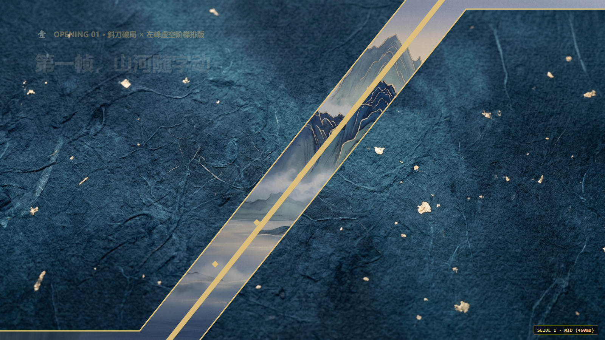
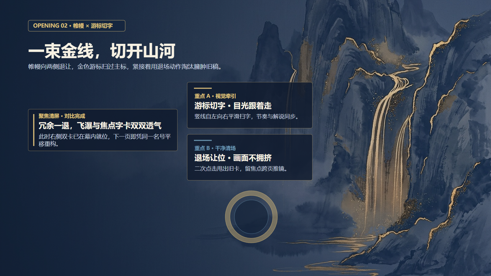
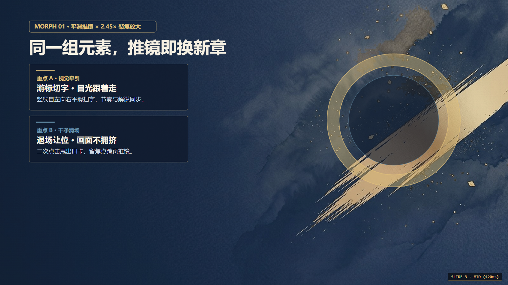
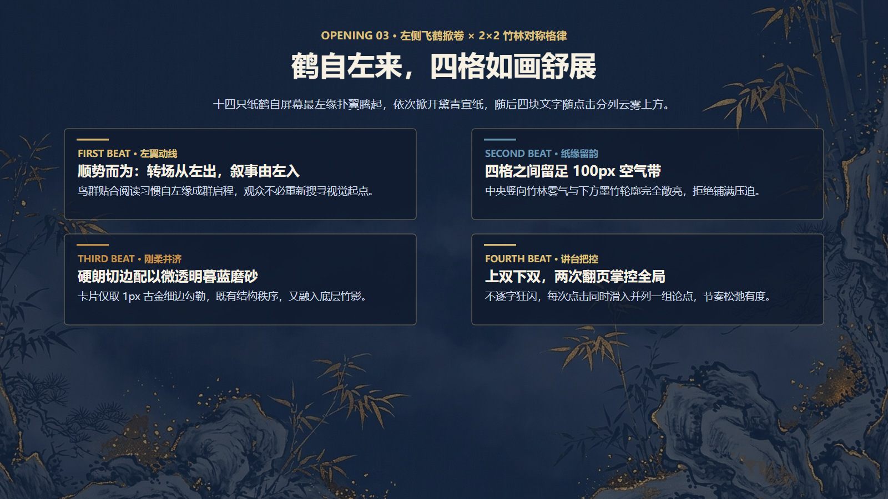
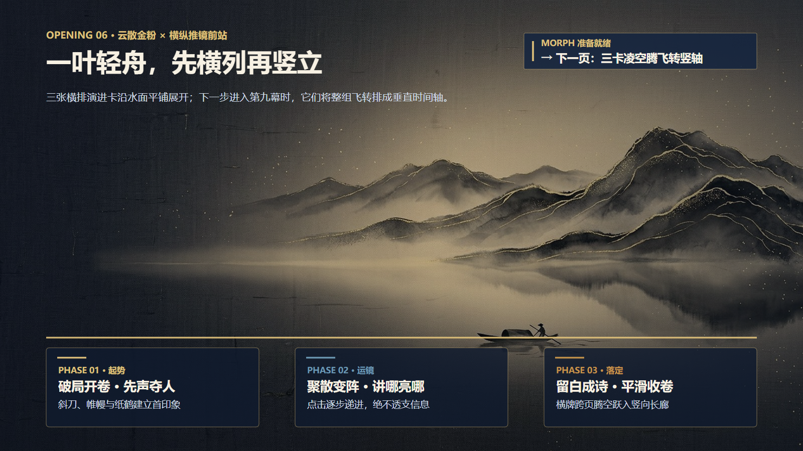
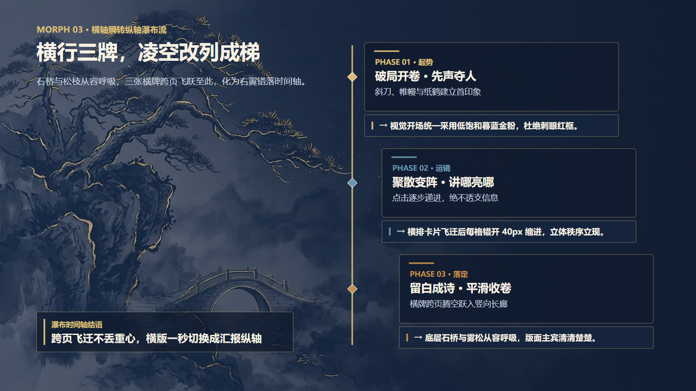
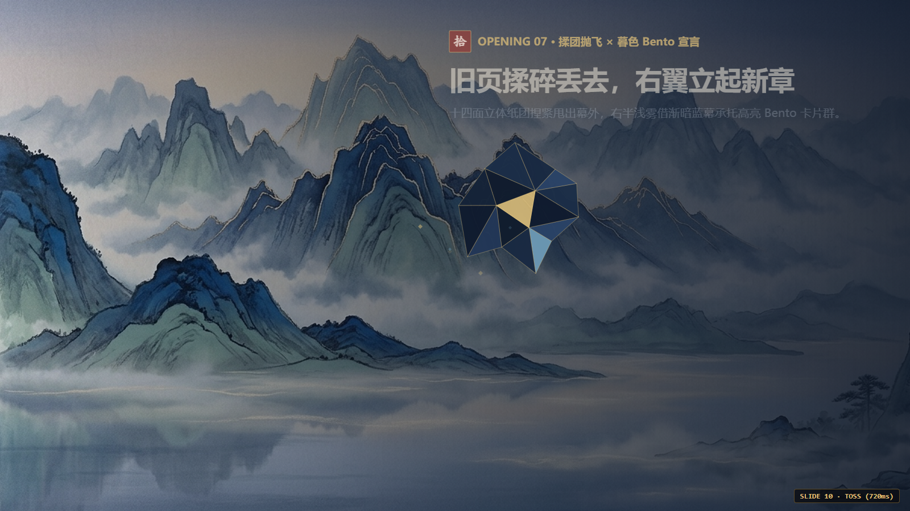
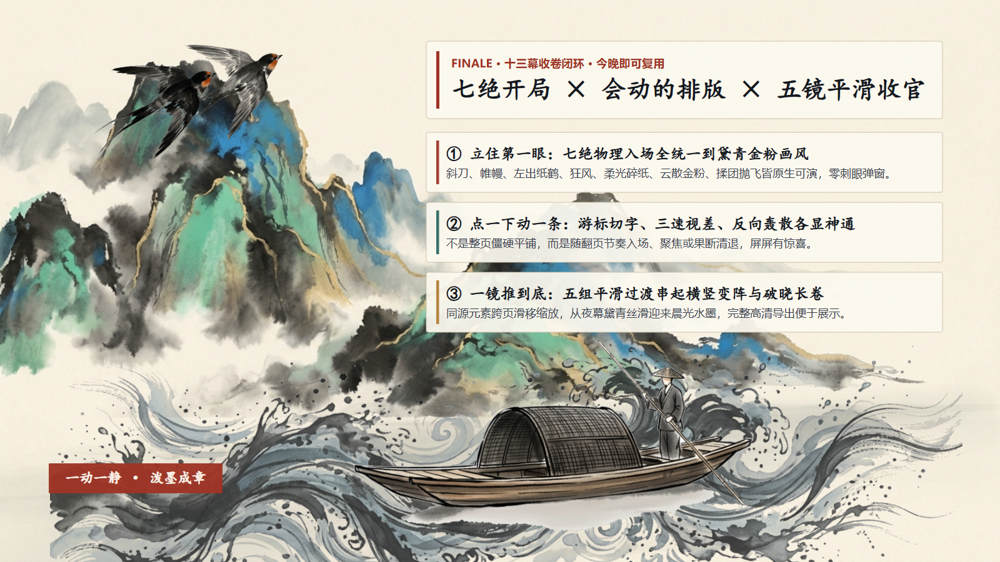

# Kinetic PPT Studio · 动效演示文稿双引擎开源工坊

<p align="left">
  
  
  
  
</p>

> **打破「PPT 只能纯色方块淡入淡出」与「靠插视频假装动效」的局限。**
> 由 **宁维 (Neve)** 整理开源的 AI Agent 演示文稿双引擎技能库，收录 **原生 OpenXML (`.pptx`) 动效与平滑推镜引擎**和 **HTML5 + GSAP + SVG/Canvas 七绝交互演示引擎**。两种格式均可用 Node.js 18+ 构建，无需安装 npm 包。原生 PPTX 面向 PowerPoint 和 WPS 演示的编辑与放映。

---

## 13 页黛青母版预览

| 01 · 斜刀劈裂开场 (`Blade`) | 02 · 游标金线切字 & 左甩退场 |
| :---: | :---: |
|  |  |
| **03 · 2.45× 平滑推镜 (`Morph #1`)** | **04 · 千纸鹤掀卷与竹林四格排版** |
|  |  |
| **08 · 云散金粉与水平时间轴** | **09 · 垂直瀑布流时间轴 (`Morph #3`)** |
|  |  |
| **10 · 两段式揉团抛飞 (`Crumple`)** | **12 · 皮影持棍送燕平滑入局（中段）** |
|  |  |
| **12 · 双燕停驻与木棍抽离（中段）** | **13 · 暖宣泼墨长卷收官 (`Morph #5`)** |
|  |  |

---

## 核心亮点

### 1. 引擎一：`pptx-kinetic-transitions`（纯原生 `.pptx` 物理动效引擎）
- **真·原生可编辑 `.pptx`**：不塞 MP4 视频、不依赖第三方插件，底层直接生成符合 ECMA-376 OpenXML 规范的 `<p:timing>`、`<p:animMotion>`、`<p:animRot>`、`<p:animScale>` 与 `<p159:morph>` 时间轴。
- **1:1 实景纹理切片 (`<a:srcRect>`)**：自动将宣纸洒金封面或全屏原画无损剖分为互补斜切半片、16 块不规则碎纸、7 道斜风长带或 14 面折纸揉团。
- **「七绝」物理开场 + 光圈**：
  1. **斜刀劈裂 (`addDiagonalBladeOpeningRig`)**：刀芒横掠 + 封面一刀两断错位滑开
  2. **立体帷幔对开 (`addPleatedCurtainOpeningRig`)**：顶部滑杆 10 环联动 + 双翼四阶明暗褶皱幕布收拢
  3. **千纸鹤左出掀卷 (`addOrigamiCranesOpeningRig`)**：14 只折纸飞鹤沿三阶贝塞尔曲线自左向右掠空，无缝牵引整幅长卷顺流揭开
  4. **狂风卷条斜剥 (`addWindRibbonsOpeningRig`)**：7 道 `-22°` 防漏缝斜带伴随 9 道气流线顺风剥离
  5. **柔光碎纸 / 乱拳破屏 (`addShardPunchOpeningRig`)**：16 块共顶点网格切片分三波炸裂，内置 `softMode` 护眼柔光薄雾
  6. **云散金粉 / 余烬近似 (`addEmberDissolveOpeningRig`)**：四方宣纸外退 + 柔光金雾扩散 + 16 粒金尘飘散
  7. **两段式揉团抛飞 (`addPaperCrumpleTossOpeningRig`)**：整幅封面急速向心拧缩，无缝交接给 14 面折纸团沿抛物线旋转抛飞
  8. **机械快门光圈 (`addShutterIrisOpeningRig`)**：中心镜盖旋缩 + 8 片叶片同步旋转外扩
- **会动的文字排版（点一下动一下）**：
  - **游标金线切字**：`0.8s` 金色激光竖线先扫过，文字框如刀切般同步向右擦出，再点一下集体向左疾甩清场。
  - **三速视差入场与上下反向轰散**：标签、主标题、正文字卡以不同初速度差错落滑入，点击后上半部向上、下半部向下反向轰散退场。
  - **五镜电影级平滑推镜 (`Morph #1–#5`)**：跨页同名 `!!name` 元素自动飞跃缩放——横排三卡腾空 90° 变为垂直瀑布流时间轴；夜幕朱印跨页化作暖白宣纸破晓长卷。
  - **皮影持棍送燕与垂直抽棍**：木棍图层与双燕图层保持 `0°` 平直同步滑入高空，落定停顿后木棍独自沿斜角向下抽离，留双燕悬停天际。

### 2. 引擎二：`ink-kinetic-ppt`（HTML5 + GSAP + SVG/Canvas 七绝网页引擎）
- 内置离线 **GSAP 3.15**（含 `CustomEase`、`SplitText`、`DrawSVGPlugin`），结合 SVG 五阶分形噪波遮罩 (`#ink-burn-mask`) 与硬件合批 Canvas，支持像素级点触水墨焚纸 (`fire`)、曲面滤镜揉纸 (`crumple`)、6 套可插拔主题（含无配图极简讲课模式 `keynote-slate` / `clean-lecture`）及教室翻页笔即插即用。
- 支持一键打包为**双击即可离线运行的单文件 `.html`**。

---

## 开箱即用成品（直接下载体验）

仓库内已预置编译好的旗舰演示成品，无需配置环境即可打开预览：

1. **原生 PowerPoint 13 页黛青终极母版**：
   - [`examples/daiqing-morph-typography/daiqing-morph-typography-showcase.pptx`](./examples/daiqing-morph-typography/daiqing-morph-typography-showcase.pptx)（`7.25 MiB`，可用 PowerPoint 或 WPS 演示打开。放映效果取决于软件版本、动效支持和本机字体。）
2. **高清 16:9 静态归档 PDF**：
   - [`examples/daiqing-morph-typography/daiqing-morph-typography-showcase.pdf`](./examples/daiqing-morph-typography/daiqing-morph-typography-showcase.pdf)（`7.08 MiB`）
3. **HTML 七绝交互单文件网页版**：
   - [`examples/ink-html-showcase/ink-kinetic-showcase.html`](./examples/ink-html-showcase/ink-kinetic-showcase.html)（浏览器双击打开，按 `→` / `Space` 或 `B/G/P/C/M/W/R` 体验 7 套网页物理转场，按 `T` 切换 6 大主题）

---

## 如何安装到你的 AI 编程助手（Claude Code / Cursor / Antigravity / WorkBuddy / Codex）

### 方式 A：整库安装（同时拥有 `.pptx` 与 `.html` 双引擎）
在本仓库主页点击 **Code**，复制 HTTPS 地址用于克隆，或选择 **Download ZIP** 后解压。将整个 `kinetic-ppt-studio` 目录放到助手的技能目录，例如工作区的 `.agents/skills/`、`.claude/skills/` 或 `.workbuddy/skills/`。

### 方式 B：按需单独安装子技能
只想要原生 PowerPoint (`.pptx`) 引擎或 HTML 引擎，直接复制 `skills/` 下的对应文件夹即可：
- 原生 PPTX 技能：`skills/pptx-kinetic-transitions/`
- 网页 HTML 技能：`skills/ink-kinetic-ppt/`

安装后直接对 AI 说：
- *「用黛青墨夜风格（`daiqing-ink-gold`）帮我做一个 10 页产品发布 `.pptx`，包含千纸鹤左出掀卷开场、游标切字排版和横排转竖排平滑推镜」*
- *「用 `ink-kinetic-ppt` 帮我生成一套极简深色讲义网页 PPT，打包成单文件 HTML」*

---

## 本地构建与二次开发

在仓库根目录运行。构建 PPTX 和打包 HTML 只需 **Node.js 18+**。

```bash
# 重新生成 13 页黛青暮蓝终极母版 .pptx
node examples/daiqing-morph-typography/build-daiqing-morph-typography.mjs

# 重新打包 HTML 单文件离线演示版
node skills/ink-kinetic-ppt/scripts/bundle-standalone.mjs --src skills/ink-kinetic-ppt/starter --out examples/ink-html-showcase/ink-kinetic-showcase.html
```

从网页演示导出 PDF 还需要 Playwright 和 Chromium。安装与运行命令见 [Ink Kinetic PPT 使用说明](./skills/ink-kinetic-ppt/README.md#pdf-导出)。

---

## 开源协议与署名 (License & Credits)

项目自有代码与文档采用 [MIT License](./LICENSE)。版权署名为 `Copyright (c) 2026 宁维 (Neve)`，再分发时请随附版权声明和许可文本。

- `skills/ink-kinetic-ppt/starter/vendor/gsap/` 中的 GSAP 3.15.0、CustomEase、SplitText、DrawSVGPlugin，以及独立 HTML 内嵌的同一套运行库，均保留上游版权声明并遵循 [GSAP Standard “No Charge” License](https://gsap.com/standard-license/)。
- 示例 PDF 内嵌的楷体和微软雅黑字体子集遵循 [原字体的文档嵌入条款](https://learn.microsoft.com/en-us/typography/fonts/font-faq)。
